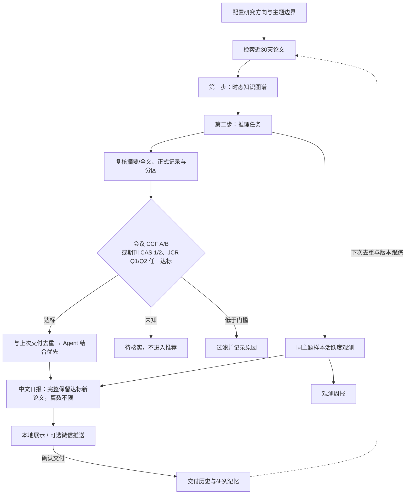

# 科研论文雷达 · research-paper-daily-push

帮助研究人员持续跟进同一方向的论文：**收集候选 → 核实证据与发表场所 → 推荐阅读 → 跟踪更新**。

既可作为 Codex Skill 使用，也提供零第三方依赖的 Python 命令。脚本处理检索、去重和报告校验；研究人员或 Codex 负责阅读论文、核实贡献。

## 工作流程



- **层层收敛**：先找时态知识图谱，再筛推理；Agent 是最后的阅读优先项，不是召回前提。
- **只收达标场所**：会议 CCF A/B；期刊中科院一区/二区或 JCR Q1/Q2，任一达标即可。未知等级留待核实，附属卷不继承主会等级。
- **不限篇数**：候选与最终推荐默认不截断，不以评分凑数或淘汰；与上次交付按 DOI、arXiv ID、题名去重，版本变化单列跟踪。

## 快速开始

需要 **Python 3.10+**。在仓库目录执行；公开配置保持空白，以下以 **Temporal Knowledge Reasoning，重点 Agent × TKG** 为例。其他领域见[配置说明](references/profile_schema.md)。

**1. 复制示例并收集候选**

```powershell
Copy-Item examples/research_profile.temporal-kg.json config/my.local.json
python scripts/run_daily.py collect --profile config/my.local.json --mode agent_tkg
```

控制台会显示 `data/runs/<scope>/<日期>/`。先读 `discovery.md`（未复核简报），再查看 `review_queue.json`（含摘要的候选队列）。

**2. 复核论文**

在已安装 Skill 的 Codex 中可直接说：

> 使用 research-paper-daily-push，按 config/my.local.json 的 agent_tkg 模式收集并复核论文。先时态知识图谱、再推理，会议 CCF A/B、期刊 CAS 1/2 或 JCR Q1/Q2 任一达标；与上次去重，Agent 结合优先，篇数不限，并展示中文日报。

也可手动生成复核草稿：

```powershell
$runDir = "替换为控制台输出的运行目录"
python scripts/run_daily.py prepare --queue "$runDir/review_queue.json" --output "$runDir/reviewed_articles.json"
```

阅读摘要或全文，按[复核数据约定](references/reviewed_schema.md)填写贡献、局限、评分与证据链接，并核对正式发表记录。**草稿不会自动完成论文阅读，未复核数据不能交付。**

**3. 生成日报**

```powershell
python scripts/run_daily.py deliver --profile config/my.local.json --reviewed "$runDir/reviewed_articles.json" --queue "$runDir/review_queue.json" --report "$runDir/daily-report.md" --skip-push
```

报告实际展示后，可增加 `--record-local-report` 确认交付、写入去重历史。微信发送需配置渠道并明确授权，见[推送设置](references/wxpusher_setup.md)。

## 来源与边界

计算机方向默认使用 **arXiv、Semantic Scholar、Crossref** 三路检索，单路失败保留其他结果，限流与临时错误有界退避重试。OpenAlex 仍暂停默认使用；生物医学预设使用 Europe PMC、bioRxiv。新配置按实际发表日期优先展示，近30天较早论文标为补充；正式发表状态与分区需另行核实。旧配置显式来源名单保持不变，启用多来源时需同步调整 `sources` 和 `disabled_sources`。

热点仅表示同主题检索样本的发文活跃度；缺源或截断时不判断升温。项目不自动创建定时任务，仅运行 `collect` 会生成待复核候选。

## 更多说明

[安装指南](references/installation_guide.md) · [研究主题示例](examples/research_topics.temporal-kg.md) · [场所评级](references/venue_catalog.md) · [来源覆盖](references/data_sources.md) · [完整 Skill 工作流](SKILL.md)

开发验证：`python -m unittest discover -s tests -v`

[MIT License](LICENSE) · [中文参考译文](LICENSE.zh-CN.md)
